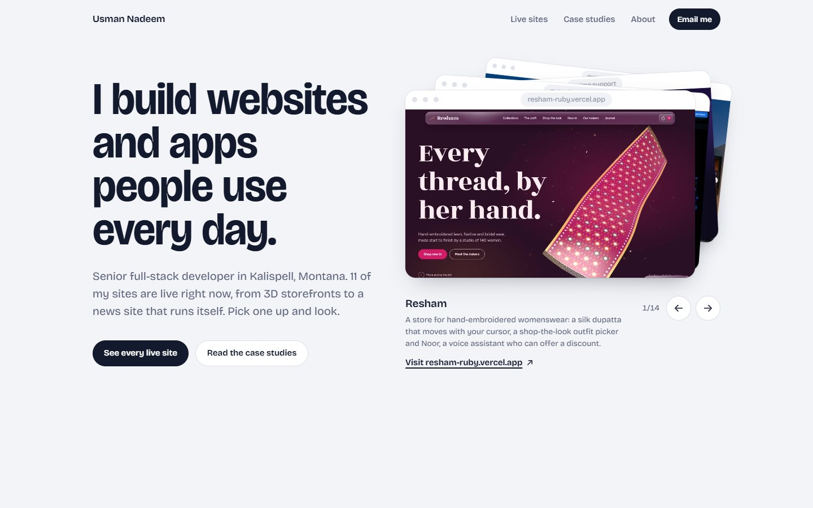
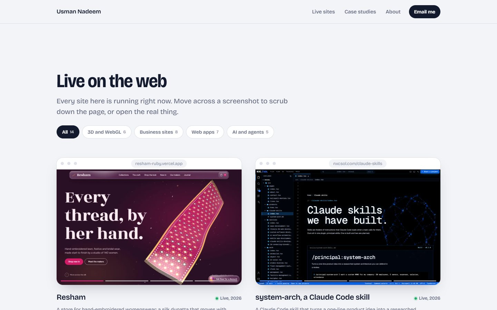
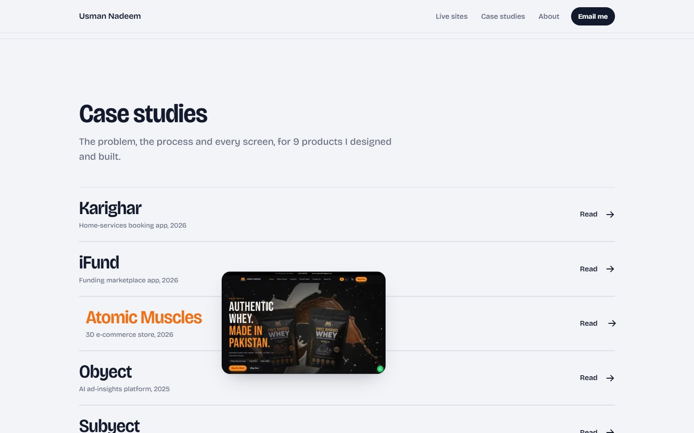
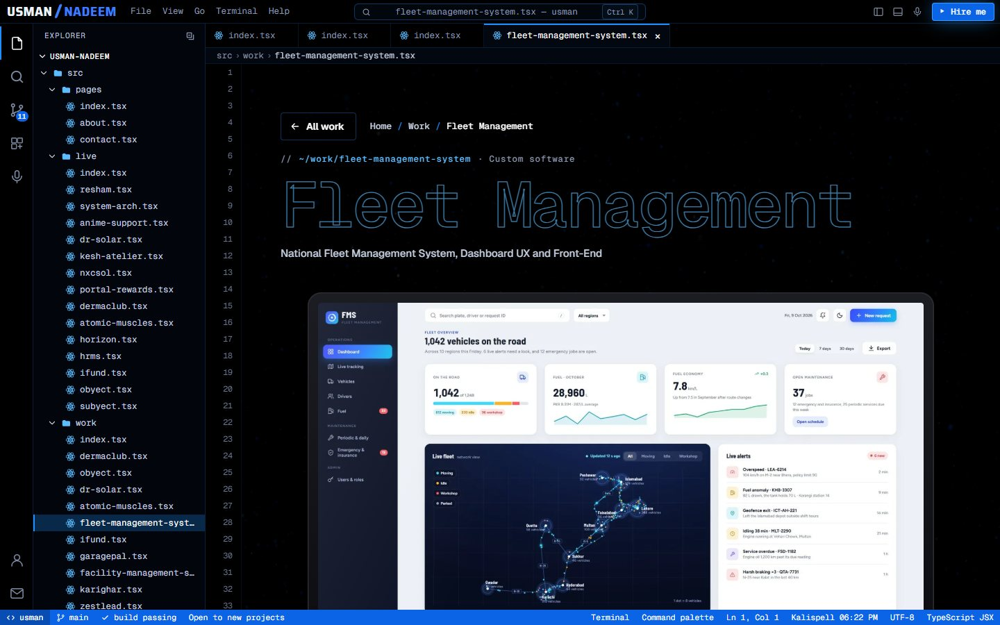
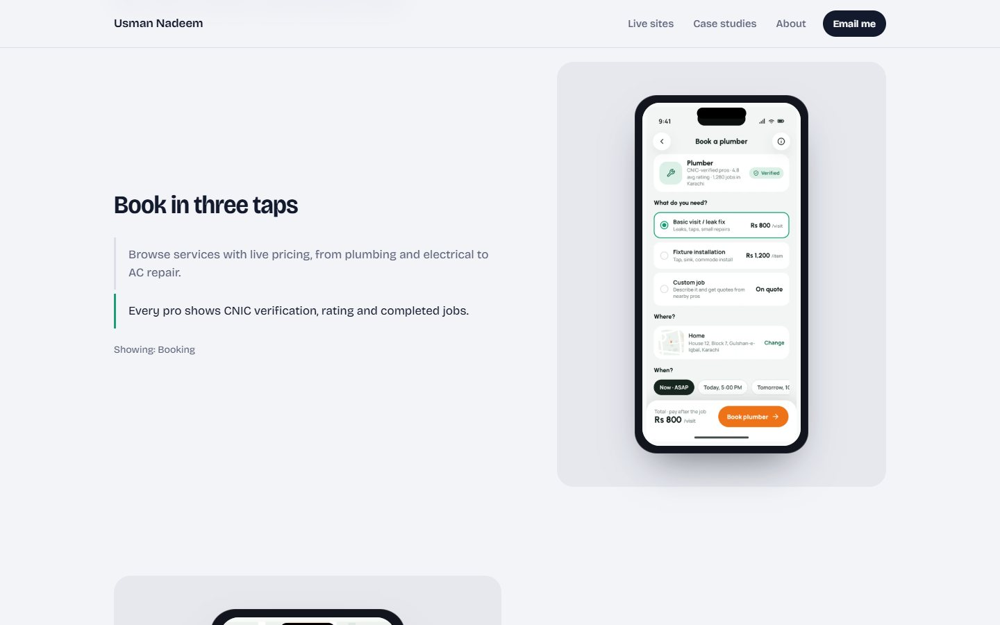
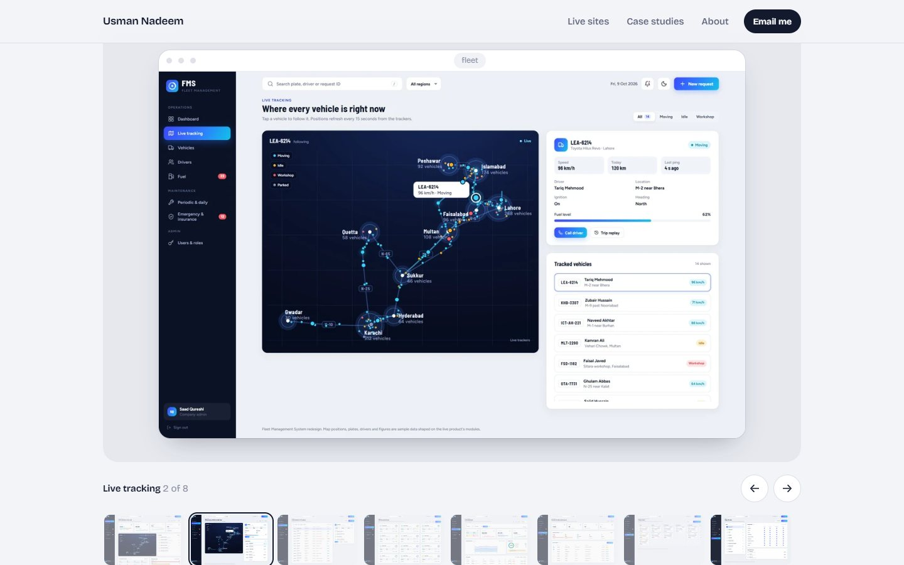
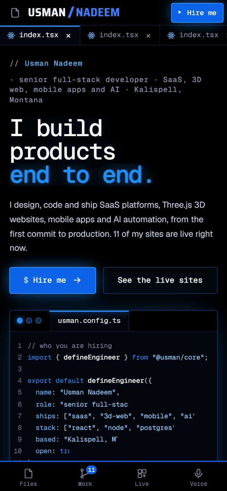
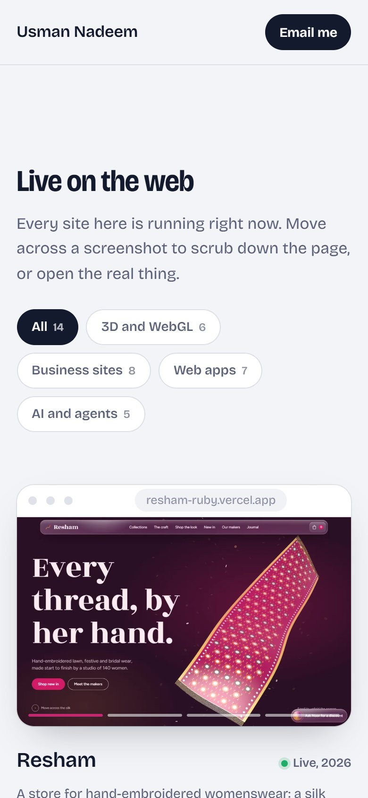
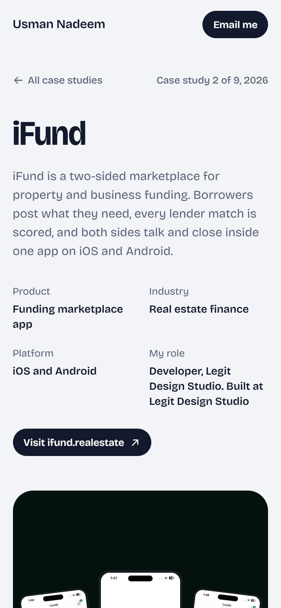

<div align="center">

# Usman Nadeem: Portfolio

**Senior full-stack developer.** I build websites and apps people use every day.

### [Visit the live site](https://usmannadeem.vercel.app)




</div>

## About this site

My portfolio: every site I have running on the web, and case studies for the products I designed and built. The page is light and quiet, and the colour comes from the work itself. Things move when you touch them, not on their own.

## Live sites

<table>
  <tr>
    <td width="50%" valign="top">
      
      <br><b>A deck of live sites</b>
      <br><sub>Drag the top card away, tap it, use the arrows or your keyboard. The caption and the link follow the card.</sub>
    </td>
    <td width="50%" valign="top">
      
      <br><b>Live on the web</b>
      <br><sub>Move across a screenshot to scrub down the real page; on a phone, tap to step. Filter by 3D, business sites, web apps, or AI and agents. The filter is kept in the URL.</sub>
    </td>
  </tr>
</table>

The 14 sites are listed in `lib/live.js`: Resham, the system-arch Claude Code skill, anime.support, Dr Solar, Kesh Atelier, NXCSOL, Portal Rewards, The Derma Club, Atomic Muscles, Horizon Analytical, HRMS, iFund, Obyect and Subyect.

## Case studies

<table>
  <tr>
    <td width="50%" valign="top">
      
      <br><b>The list</b>
      <br><sub>Hover a project and its main screen follows the cursor. On a phone each row carries a thumbnail.</sub>
    </td>
    <td width="50%" valign="top">
      
      <br><b>A case study</b>
      <br><sub>The overview, the facts, and the product on its own colour. The devices rise in once when the page opens.</sub>
    </td>
  </tr>
  <tr>
    <td width="50%" valign="top">
      
      <br><b>Features you can click</b>
      <br><sub>Each feature line is a button. Pick one, or hover it, and the screen beside it changes to match.</sub>
    </td>
    <td width="50%" valign="top">
      
      <br><b>Every screen</b>
      <br><sub>One viewer for every screen: arrows, thumbnails, the keyboard or a swipe. Palette swatches copy their colour when tapped.</sub>
    </td>
  </tr>
</table>

## On a phone

<p align="center">
  
  
  
</p>

## Tech stack

| Area | Tools |
| --- | --- |
| Framework | Next.js 16 (App Router, static prerender), React 19 |
| Animation | Motion: springs, drag and presence, only in answer to what you do |
| Styling | Tailwind CSS 3 and `app/pf.css` |
| Type and icons | Bricolage Grotesque (its width and optical-size axes), Phosphor Icons |
| Hosting | Vercel |

Reduced motion is respected everywhere: the deck and the case-study devices stop animating and every screen still shows.

## Run it locally

You need Node.js 20 or newer.

```bash
npm install
npm run dev
```

Then open http://localhost:3000. For a production build, run `npm run build` and then `npm run start`.

Every push to the `main` branch redeploys the site on Vercel.

## Editing the content

| What | Where |
| --- | --- |
| Live sites: name, link, status, filters, stack, screenshots | `lib/live.js` and `public/live/<slug>/f1.webp` to `f4.webp` (1200x750) |
| Case studies: overview, problems, process, features, screens, palette, fonts | `lib/caseStudies.js` and `public/work/<project>/` |
| About text, skills, experience, education | `lib/profile.js` |
| Site address, email, phone, social links | `lib/site.js` |

## Project structure

```text
app/                  home page, layout, pf.css, and /work (case-study index and pages)
components/pf/        header, deck, live sites, case list, case-study parts, frames, sections
lib/                  live sites, case studies, profile, site settings, screenshot helpers
public/live/          screenshots taken down each live site
public/work/          app screens and captures for the case studies
docs/screenshots/     images used in this README
```

## Contact

- **Email:** [usmannadeem3621@gmail.com](mailto:usmannadeem3621@gmail.com)
- **LinkedIn:** [usmannadeem-dev](https://www.linkedin.com/in/usmannadeem-dev)
- **GitHub:** [Matanza00](https://github.com/Matanza00)
