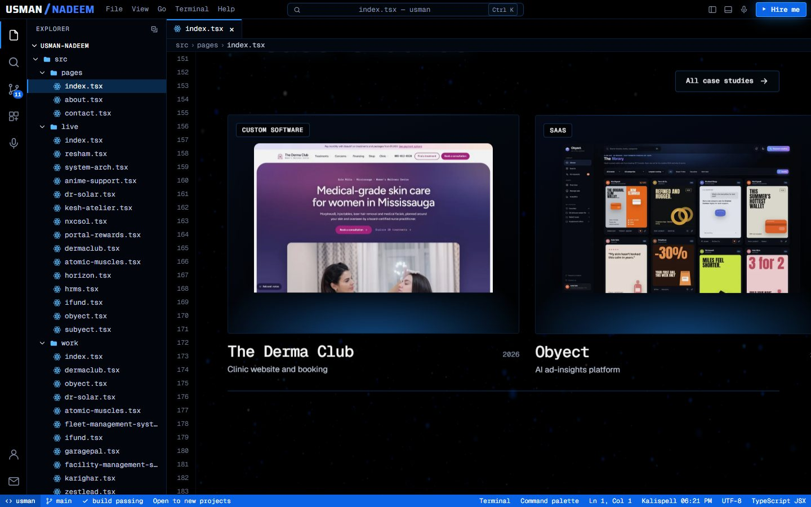
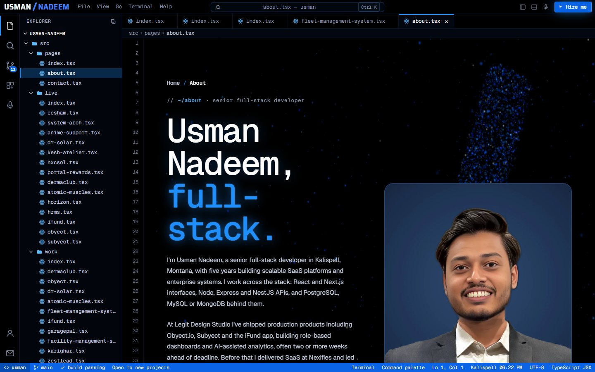

# Usman Nadeem: Portfolio

**Senior full-stack developer.** I build products end to end.

### [Visit the live site](https://usmannadeem.vercel.app)

## About this site

My portfolio, built inside the same VS Code frame as [nxcsol.com](https://nxcsol.com), my software company's site. The pages are files in an Explorer, every page you open stays as a tab, and there is a working terminal, a command palette, a minimap and a status bar. Pages change under a slash without reloading.

## What is on it

<table>
  <tr>
    <td width="50%" valign="top">
      
       <b>Live on the web</b>
       Fourteen sites running right now. Move across a screenshot to scrub down the real page, tap to step through, filter by 3D, business sites, web apps or AI.
    </td>
    <td width="50%" valign="top">
      
       <b>Case studies</b>
       Eleven products, each with the problem, the stack and why, the people who use it, and every screen.
    </td>
  </tr>
  <tr>
    <td width="50%" valign="top">
      
       <b>Experience as a git log</b>
       Every role as a commit, the numbers as a passing test run, and the skills as a package.json.
    </td>
    <td width="50%" valign="top">
      
       <b>About</b>
       Tap the photo to repaint the wall behind me. The voice assistant (an ElevenLabs agent) talks about my work and opens pages while it talks.
    </td>
  </tr>
</table>

  
  

Try the terminal: <kbd>Ctrl</kbd> + <kbd>`</kbd>, then `help`, `ls`, `open fleet-management-system`, `whoami`. <kbd>Ctrl</kbd> + <kbd>K</kbd> opens the command palette and <kbd>Ctrl</kbd> + <kbd>B</kbd> toggles the Explorer.

## How it is built

The site in `site/` is static HTML, CSS and JavaScript, prerendered page by page. Vercel serves it as it is (see `vercel.json`); there is no build step on Vercel.

It is generated by `research/usman-vs/build_me.py` in my workspace, a fork of the generator behind nxcsol.com:

| What | Where |
| --- | --- |
| Live sites, experience, education, skills, contact details | `research/usman-vs/me.data.js` |
| Home, live sites, about, contact pages | `research/usman-vs/me.views.js` |
| The VS Code frame: Explorer, tabs, terminal, status bar | `research/usman-vs/vs.views.js`, `vs.client.js` |
| Case studies | `research/usman-vs/cs.data.js`, `why.data.js` |
| Scrub, photo and voice assistant | `research/usman-vs/me.live.js`, `me.voice.mjs`, `me.css` |
| Live-site screenshots and my photo | `public/live/<slug>/`, `public/me/` |

Rebuild with `python build_me.py`, then commit `site/`. Every push to `main` redeploys.

## Contact

- **LinkedIn:** [usmannadeem-dev](https://www.linkedin.com/in/usmannadeem-dev)
- **GitHub:** [Matanza00](https://github.com/Matanza00)
- Email and phone are on the [contact page](https://usmannadeem.vercel.app/contact/).
